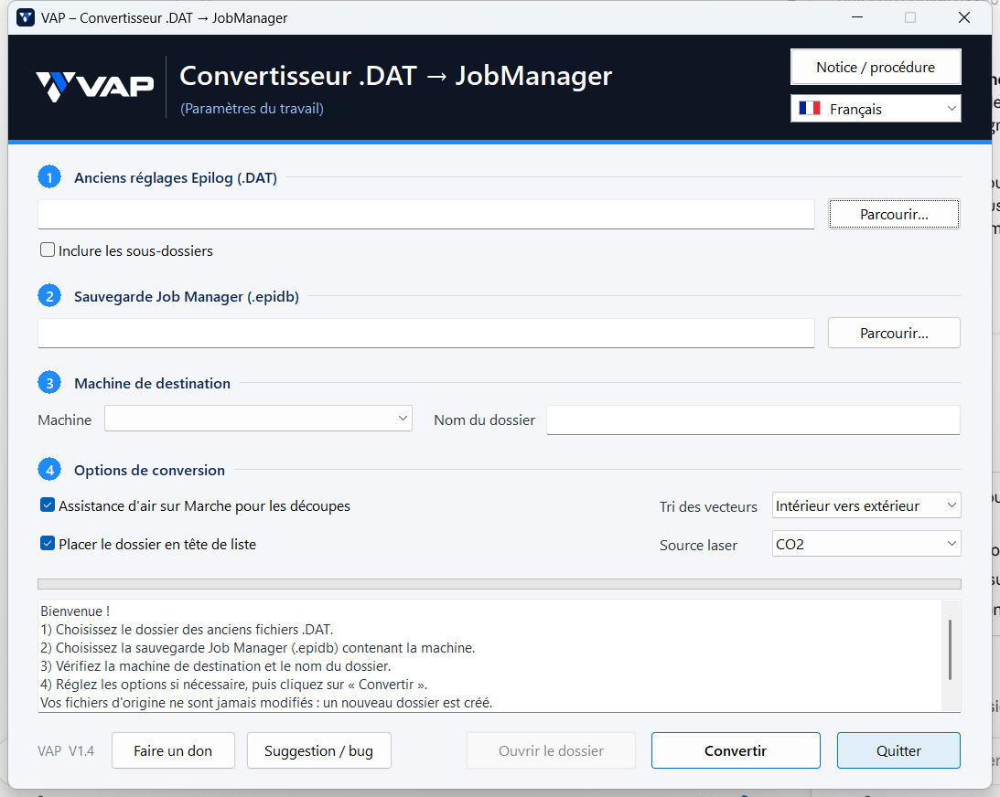

<p align="center"></p>

# VAP Convertisseur Epilog

Vos anciens réglages Epilog (fichiers **.DAT** des anciens pilotes) passent dans **Epilog Job Manager** en un clic, déjà rangés par machine, sans rien ressaisir.

**[⬇ Télécharger la dernière version (V1.4)](../../releases/latest)**

Gratuit · Windows 10 et 11 · 9 langues · aucune installation



## Machines prises en charge

- Mini, Mini+ et Helix
- Zing et Zing+
- Fusion et Fusion+, CO2 et Fibre

## Comment l'utiliser

1. Dans Job Manager, faites une sauvegarde de la base de données (« Backup Database »).
2. Dans le convertisseur, choisissez le dossier des anciens .DAT, puis cette sauvegarde.
3. Cliquez sur « Convertir », puis restaurez la nouvelle base dans Job Manager (« Restore Database »).

La notice complète est dans le programme (bouton « Notice / procédure »). Vos fichiers d'origine ne sont jamais modifiés.

## Ce qui est repris

Puissance, vitesse, résolution, fréquence, type de travail, trame, sens de gravure, autofocus, tri des vecteurs, mode Tampon et 3D, position du travail, gestion des couleurs, nombre de passes, et pour la Fusion : source Fibre, épaisseur et décalage, compensations et grille de découpe. L'assistance d'air est mise sur Marche pour toutes les découpes.

Le détail des versions est dans [NOTES_DE_VERSION.md](NOTES_DE_VERSION.md).

## Un problème ou une idée ?

Cliquez sur « Suggestion / bug » dans le convertisseur, ou ouvrez l'onglet **[Issues](../../issues/new/choose)**. Joignez si possible le fichier .DAT concerné.

Pas de compte GitHub ? Écrivez à **vapfrenchtec@gmail.com**.
## Soutenir le projet

Le convertisseur est gratuit. Pour soutenir son développement : bouton « Faire un don » dans le programme, ou [paypal.me/VAPTechnologie](https://www.paypal.com/paypalme/VAPTechnologie).

## Pour les développeurs

Programme Windows écrit en Go, sans dépendance externe (interface Win32, base SQLite par `winsqlite3.dll`). Sources dans [`sources/`](sources/) :

```
go-winres make --in res/winres.json --arch amd64 --out rsrc
GOOS=windows GOARCH=amd64 CGO_ENABLED=0 go build -trimpath -ldflags "-H windowsgui -s -w" -o "VAP Convertisseur Epilog.exe" .
```

Licence MIT — © 2026 VAP Technologie (voir [LICENSE](LICENSE)).

Epilog, Job Manager, Mini, Helix, Zing et Fusion sont des marques d'Epilog Laser. Ce projet n'est pas affilié à Epilog Laser.
